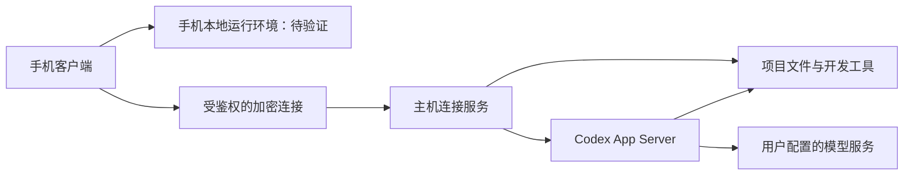

# 技术方案草案

状态：已有 Windows/Android 安装包原型；本文同时保留后续设计方向。安装包流程及设备验证边界见[双端 App](native-apps.md)，已有协议验证见[验证记录](validation-2026-10-31.md)。

## 当前实现

- `src/host/rpc.ts`：管理官方 App Server 子进程和 stdio JSON-RPC，处理通知、回调、超时与退出。
- `src/host/service.ts`：提供会话/任务接口、审批路由、事件序号与缓存，持久化操作意图以防重复提交。
- `src/host/projects.ts`：校验真实授权路径，包括符号链接与 Windows junction；展示根目录和直接子目录。
- `src/host/auth.ts`：单次短时配对、设备凭据哈希、有效期与撤销。
- `src/host/server.ts`：同源 HTTP API、SSE 与事件轮询，校验 Host/Origin，仅公开具体业务操作。
- `src/web/`：React 手机网页入口，按当前主机和选中会话恢复历史与审批，不自动重发指令。
- `src/host/runtime.ts`：可嵌入的启动/停止生命周期、动态连接地址与连接码。
- `src/desktop/`：Electron 电脑 App，管理目录、内置 CLI、配对及固定版本 Cloudflare HTTPS 隧道。
- `apps/android/`：原生 Activity、Keystore、受限 API/SSE 桥接、系统文件保存、前台服务与事务式 Linux 环境安装。HTTPS 连接使用每秒事件轮询以适配临时隧道，LAN/本地使用 SSE；二者共用事件序号、进程标识及缺口恢复。原生桥只暴露给 APK 内置界面，远端页面不能获得桥接能力。
- `tools/`：生成版本特定协议，运行真实协议/模型探针与 Android/Linux 检查入口。

本轮选择 TypeScript + Fastify 主机和 React/Vite 网页，以尽快验证真实协议链路。模型密钥沿用 Codex 主机配置，或仅通过子进程环境注入；状态文件不保存 API Key。设备与提交意图保存在可配置的 `.runtime/`。

主机服务拥有自己的 App Server；同一服务内可以控制它发起的任务。桌面 App 的其他进程运行状态无法可靠判定，因此已有会话接续有显式空闲确认，不能保证跨进程互斥。实时轮次缓存覆盖新会话尚未落盘和首轮空日志边界，随后与持久化历史合并；事件缺口补载历史，工具输出尚未落盘时可能仍不完整。原型提供有限协议投影，并保留 CLI 生成的请求 Schema 用于升级核对。

## 总体结构

连接服务部署在个人电脑或用户自己的常驻主机上。远程模式下，手机负责交互，主机负责模型调用、项目文件和任务执行。本地模式下，这些任务由手机上的运行环境承担，模型请求仍通过网络发送给服务商。手机与电脑连接到同一主机时，操作同一份项目和会话；不同主机之间的迁移需要另行实现。

## 从 dsh-Go 借鉴的结构

[源码分析](references/dsh-go.md)表明，dsh-Go 将本机、SSH、Remote 主机统一建模，并在传输层之上共用会话客户端。Codex Go 应借鉴这一边界：

- **运行主机**：手机、电脑、常驻服务器，拥有自己的项目、凭据与会话。
- **连接传输**：本地进程通信、SSH 或后续中继，不进入聊天界面的业务逻辑。
- **Codex 协议适配**：负责会话、任务、审批、事件及版本兼容。
- **移动界面**：使用统一能力接口，并按主机实际能力启用功能。

DSH 的会话和设置接口不能直接套用到 Codex；上述划分是结构参考。

## 已有文档依据

以下能力于 2026-10-31 核对官方文档，并已完成本版本的基础运行验证；详细边界见验证记录。

| 能力             | 文档依据                                                                        | 对本项目的意义                                      |
| ---------------- | ------------------------------------------------------------------------------- | --------------------------------------------------- |
| 自定义模型服务商 | 高级配置支持 `model_provider`、`model_providers`、`base_url` 和 `env_key`。     | 可探索直接接入兼容服务，无须先修改 CLI 的认证代码。 |
| 创建与接续会话   | App Server 提供 `thread/start`、`thread/resume`、`thread/read`、`thread/list`。 | 能以会话 ID 为基础实现历史浏览与继续工作。          |
| 任务与交互       | App Server 支持 `turn/start`、`turn/steer`、流式事件及审批交互。                | 可为手机提供完整任务界面，而非仅转发聊天文本。      |
| 客户端协议       | App Server 使用双向 JSON-RPC，支持默认 stdio 及其他传输方式。                   | 连接服务可以管理本地子进程并转换为面向手机的接口。  |
| 协议生成         | CLI 可生成该版本对应的 TypeScript 和 JSON Schema。                              | 原型应固定版本，并用生成的协议约束适配层。          |

来源：[Codex App Server](https://developers.openai.com/codex/app-server/)、[Codex 高级配置](https://developers.openai.com/codex/config-advanced/)。

官方将 App Server 命令及 WebSocket 传输标为实验性，并说明其生产使用限制；默认 stdio 的存在不消除 App Server 自身的成熟度限制。上述接口不等同于 Codex 桌面 App 的全部内部能力。

## 接入路线

### 优先验证：连接服务 + 官方 App Server

连接服务在主机上启动并管理 `codex app-server`，优先以本地 stdio 通信；向手机提供单独的、经过鉴权的加密连接。主机侧处理会话查询、项目授权、任务状态、执行审批与模型配置。

选择这一方案的理由是它覆盖了需要的基础交互，可以减少与上游 CLI 分叉带来的维护成本。它是否足够支持桌面已有会话，需要先完成兼容性验证。

### 备选：修改 Codex CLI

如果公开协议不能支持必须的会话接续能力，记录具体缺口，再评估是否通过适配、上游贡献或维护修改版本解决。当前尚未决定 fork，也未将第三方桌面界面的私有数据结构作为稳定接口。

### 手机本地运行：Android 原型

dsh-Go 使用 Flutter 界面、Kotlin 平台层、Ubuntu 用户态与 PRoot 运行 Node.js 版 DSH。可参考其安装校验、进程管理、前台服务和故障恢复设计，单独验证 Codex 的运行条件。

Codex 使用 Rust 运行时，Android 的架构、可执行文件、文件权限、进程启动和沙箱条件均需实测。DSH 在 PRoot 内运行成功不能证明 Codex 也能直接运行，更不能证明两者能提供相同的隔离。验证应覆盖最小命令执行、读写项目、协议通信、停止与恢复、后台行为和实际权限边界。

当前已实现 Java 原生 Android 宿主和 ARM64 安装包，共用已验证的 React 界面。API Key 保存在 Keystore 加密存储，通过进程环境传给本地 Codex。项目保存在独立的持久 `/root` 映射中；运行环境先校验、解压到临时目录，再切换，更新不覆盖项目。手机本地只启用整个 App 环境内访问及可调批准策略，避免把不可用的 PRoot 内 Linux 沙箱展示成有效隔离。设备上的启动、工具执行和恢复仍待验证。iOS 的本地执行需要独立评估。

## 桌面会话接续验证

`thread/resume` 支持接续 App Server 能访问的持久化会话。这不能直接证明独立连接服务能够发现和控制桌面 App 的所有会话，更不能证明两个进程能够同时控制一个正在运行的任务。

原型必须核对：

1. 桌面 App 与 CLI 的具体版本、运行主机、Codex 数据目录和模型服务商配置。
2. 连接服务能否列出桌面创建的会话，是否存在来源、服务商或目录筛选造成的遗漏。
3. 能否读取历史并在空闲会话中追加新一轮，保持原会话 ID 与工作目录。
4. 桌面与手机交替接续后，双方能否看见新增历史与文件变化。
5. 正在运行、等待审批和断线中的会话，是否存在受支持的订阅与控制路径。
6. 若需要交接执行权，交接如何停止新任务、确认原任务状态并避免重复执行。

兼容性按层记录：历史可读、空闲会话可接续、运行中可观察、运行中可控制、桌面与手机往返接续。尚未验证的层级不能标为已支持。

## 模型服务兼容性

用户输入的服务地址、模型和密钥应属于主机级的模型配置。官方文档说明服务商相关配置应放在用户级配置中，不能假设项目内的 `.codex/config.toml` 可以覆盖这些字段。项目代码不应携带模型密钥。

中转服务不仅需要能接受普通聊天请求，还需要兼容所选 Codex 版本实际使用的协议。最初验证范围至少包含 Responses 请求、流式输出、工具调用及多轮上下文；文件、图片等能力独立标记。仅支持 Chat Completions 的服务需要额外适配评估。

测试使用用户明确选择的服务与凭据，不预设服务商、模型或付费额度。

## 连接、状态与权限

- Windows App 提供局域网连接及可选 Cloudflare 临时 HTTPS 隧道；公网配对、鉴权和模型事件已验证，手机跨网实测待完成。同一 Wi-Fi 的默认直连使用 HTTP，可选择外网 HTTPS 通道。浏览器安全上下文要求与 Android 原生网络连接分别处理。
- 配对使用短时凭据，后续设备凭据可撤销；模型密钥与设备凭据用途分开。
- 连接服务验证访问身份、浏览器来源和消息权限；不把未鉴权的 App Server 监听端口直接暴露到公网。
- 项目目录需要授权；新建、克隆和文件访问校验真实路径、符号链接与 Windows junction，不能只检查字符串前缀。
- 状态至少区分主机离线、连接中、会话空闲、执行中、等待审批、已完成、失败和中断。
- 任务提交带请求标识；重连先查询任务状态，再决定是否重试。事件若不可回放，应补载持久化历史并明确缺失范围。
- 同一会话的写入与审批需要明确执行归属；不能假设对话日志本身提供跨进程互斥。

## 技术选择状态

桌面项目目录来自 experimental `project/list`，保留保存的名称与多根目录。经配对的用户点选目录后，连接服务仅登记该已存在项目根的访问授权，写入自身的 `projects.json`；不写桌面注册表。目录授权继续使用 realpath 与路径包含关系校验。当前会话按 cwd 查找，独立 worktree 和其他主机不自动扩权。

文件交付使用独立的 `ProjectFiles` 模块：鉴权后的目录列表与附件流均限定在当前项目，排除私有路径、越界 symlink/junction、目录与大于 200 MB 的文件。下载使用 `Content-Disposition: attachment`，不把生成的 HTML 作为同源页面执行。网页将回复中的本地文件链接和文件修改映射到下载接口；仅用查询参数传路径。

会话权限由 `permissionProfile/list` 提供主机允许的内置模式，`thread/settings/update` 修改，通知 `thread/settings/updated` 确认。连接服务缓存裁剪后的有效设置，持久化用户选择供重启后的接续使用；运行中、未接续或正在改权限的会话不能同时发起设置变更。模型任务在设置变更期间也不能启动。不会修改用户全局配置。

| 部分         | 初步建议                                                   | 状态                               |
| ------------ | ---------------------------------------------------------- | ---------------------------------- |
| 手机界面     | Android 原生宿主与内置 React 界面                          | APK 构建及 lint 通过，实机待测     |
| 主机运行时   | 官方 Codex CLI / App Server stdio                          | 已验证固定版本                     |
| 主机连接服务 | TypeScript / Fastify，封装会话、配对、项目与权限           | 已实现首个原型                     |
| 主机平台     | Windows Electron 安装程序及 ZIP，再扩展常驻 Linux 主机     | 已生成 Windows 安装包              |
| 远程连接     | 连接码、LAN 直连与 Cloudflare 临时 HTTPS 隧道              | 公网协议验证通过，手机实测待完成   |
| 手机本地执行 | 校验安装 ARM64 Linux、Node、Git、Codex，PRoot 提供兼容环境 | APK 已包含运行环境，设备执行待验证 |

项目名中的 `Go` 表达移动使用场景，目前不代表已经选择 Go 语言。
